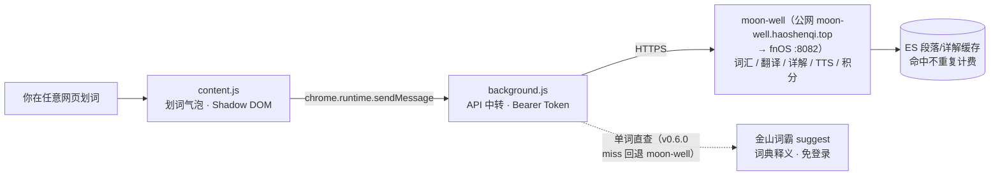

# MagicLens 词镜

把 magicbook 的阅读能力带到整个 Web 的 Chrome 扩展：在**任意网页**上划词翻译、查看单词详解、自动高亮生词、标记认识/生词、朗读，数据与词汇表和 magicbook / moon-well 完全互通——整个互联网都是你的英文书。

> 命名寓意：透镜（lens）= 对准任意页面，透视出翻译、生词与朗读；与 magicbook 同姓 magic。

## 架构

插件是纯前端，调用 [moon-well](https://github.com/haoshenqi-family/moon-well) 的 API（v0.4 起后端有配套改动：单词详解接口 + magicbook-vocabulary 缓存索引）：

- 为什么请求经 background 中转：MV3 中 content script 的 fetch 遵循页面源 CORS 规则，service worker 持有 `host_permissions` 豁免，且不受 http 页面的混合内容限制。
- 为什么 UI 用 closed Shadow DOM：与页面样式完全互不干扰。

## 当前状态（P0）

| 能力 | 状态 | 实现 |
| --- | --- | --- |
| 划词翻译（单词/段落，≤2000 字符） | ✅ | 单词先直连金山词霸词典（v0.6.0，免登录、百毫秒级，tooltip 来源 `iciba`），miss/异常回退 `POST /vocabulary/reading/translate`（ES 缓存 + AI 翻译）；**v0.8.5 起在 `iframe` 正文里同样可拖选**（含 magicbook 阅读器的 epub.js 同源 iframe——此前 iframe 内只有悬浮生词与点高亮词两条路，拖选没接进来） |
| 单词详解（v0.4.0） | ✅ | `GET /vocabulary/detail/{word}`：六板块（基本意思/词源/搭配·用法·习语/变体与衍生词/同反义词/俚语冷知识）；划词变体自动还原词目（ran→run）；moon-well 侧 ES 缓存（magicbook-vocabulary 索引），重复查询不重复计费 |
| 标记认识 / 加入生词本 | ✅ | `GET /vocabulary/known/{word}` · `GET /vocabulary/unknown/{word}`；标完本页所有同词形（含常见变形）即时点亮/熄灭 |
| 生词智能高亮（v0.5.0；v0.7.2 起 支持 magicbook 阅读器 iframe 正文） | ✅ | 英文页自动扫描 `POST /vocabulary/reading/analyze`（手动标记优先 + 分级词档兜底，与 magicbook 阅读器同一判定矩阵），生词波浪线标注（CSS Custom Highlight API，零 DOM 改动）；**悬浮生词直接弹出完整划词气泡**（v0.7.1，悬停 ~200ms，含翻译/详解/标记/AI 全部按钮，不实际选中、点击跳转元素不受影响）；点高亮词同样唤起气泡；SPA 动态内容增量判定（`POST /vocabulary/familiar`）；网页生词顺带进入与 magicbook 互通的阅读事件流。开关：popup 或 `Alt+U`；「重新扫描本页」在 popup |
| 划词朗读 | ✅ | **单个英文单词走有道 dictvoice 词库真人音频**（免 key、type=2 美式，v0.8.10 起，与 magicbook 阅读器划词发音同构）；短语/句子以及外链被页面 CSP 挡住/断网时回退浏览器 speechSynthesis；不走后端、零积分消耗 |
| 域名管理（v0.8.0） | ✅ | 在设置页维护「禁用 MagicLens 的域名」名单（匹配该域名及其全部子域，输入完整网址/带端口/带 `*.` 前缀均可，自动归一化）；扩展弹窗可一键禁用/恢复当前站点。名单随浏览器账号同步，变更对已打开页面**刷新后生效** |
| 设置页 | ✅ | 登录化（v0.3.0）：Authentik OIDC 登录 + 回调自动捕获令牌 + 401 静默刷新；无手动配置项。单词难度等级、词汇量测试等详细设置在 magicbook「阅读设置」页管理，设置页提供直达链接（v0.6.1） |
| 常驻入口悬浮球（v0.8.17；v0.8.18 对齐 magicbook R223 形态） | ✅ | 设置页开关「常驻入口」：开启后所有网页右下角显示悬浮球——**与 magicbook 伴读悬浮球同形态**：显示你装备的 buddy 伙伴形象（透明头像球，未装备回落蓝色「AI」底；来自 moon-well 伙伴目录），**hover 弹出径向快捷气泡**（类 iPhone AssistiveTouch：💬 对话开伴读抽屉〔恒第一位〕、〰 生词高亮开关〔同 Alt+U〕、🎓 每日学习 / 📚 书库 / 👤 我的新标签打开 magicbook）；可拖拽、松手吸附左右边缘并记住位置（按站点）；气泡 350ms 延迟关闭、展开方向自适应屏幕边缘。已打开页面**实时生效**（无需刷新），域名管理名单站点、主开关关闭时不显示；**首次安装会自动打开设置页并引导选择是否开启**（默认关闭，存量用户升级后不突现） |
| AI 伴读聊天抽屉 | ✅（v0.2.0；v0.8.11 修好会话列表；v0.8.15 对齐 magicbook R232/R233；v0.8.16 对齐 R227 语音双向） | `POST /ai/agent/chat` SSE 直连 content script；会话/记忆/学情面板；划词「问 AI」联动；moon-well 前置（web prompt + skipMemoryExtract）已上线。**打开抽屉默认起新会话**，续聊从左上角下拉里选（网页会话带「[通用]」前缀）；列表拉不动时下拉会直接显示失败原因，不再静默空着。**回复不再显示 token 用量**（v0.8.15，与 magicbook R232 同口径，用量只在 magicbook 设置·积分查）；回复与历史里的本站链接（`/me`、`/credits`、`/book/N` 等）安全渲染为可点链接，固定新窗口打开（v0.8.15，与 magicbook R233 同口径；外链与代码块不转链接）。**语音双向**（v0.8.16，与 magicbook R227 同口径）：🎤 点击开始/停止录音（offscreen 文档采集，麦克风权限归扩展、逐站点免授权），转写文字追加进输入框可编辑后发送、不自动发送；每条助手回复带「🔊 朗读本条」（手动点击、`/tts/speak` 1 积分/次、长回复 ≤1800 字分段顺序播并显示进度），再点停止，关抽屉/切会话即停 |
| 段落整页翻译 | 规划 P1 | `translate-batch` |
| moon-well 声音朗读（AI TTS） | 部分接入（v0.8.16） | `POST /tts/speak`——伴读抽屉「朗读本条」已接（1 积分/次，听=消费；不带书籍上下文落 7 天临时档）；划词朗读仍走有道词典真人音频 + 浏览器语音，不经后端 |

## 安装（开发者模式）

> 正式版可从 [GitHub Releases](https://github.com/haoshenqi-family/magiclens/releases) 直接下载 `magiclens-extension-vX.Y.Z.zip`，解压得到 `extension/`（用户确认可发布后 merge 到 `release` 分支的纯 `X.Y.Z` 版本自动发布；带 `-YYYYMMDDHHmm` 时间戳后缀的是测试版，不发 Release）。克隆仓库则始终是最新开发版。
>
> 扩展**不上架 Chrome Web Store**，仅通过 GitHub Releases 分发：更新时需重新下载 zip 并在 `chrome://extensions` 重载（无自动更新）。

1. 克隆本仓库（或使用 Releases 下载解压的 `extension/`）；
2. Chrome 打开 `chrome://extensions`，右上角开启「开发者模式」；
3. 「加载已解压的扩展程序」，选择本仓库的 `extension/` 目录；
4. 点击扩展图标 → 「设置」→ **「登录」**：打开 moon-well 的统一登录页（Authentik，与 magicbook 同一账号），成功后令牌自动保存并静默续期（access 30 天 / refresh 90 天，moon-well 默认值，可配置），**无需手动填任何 Token**。后端固定走公网域名 `https://moon-well.haoshenqi.top`（Server 2 Traefik → fnOS，含 X-User-* 信任头剥离），内外网均可用。还没有账号？设置页点 **「注册」** 走邀请制流程（与 magicbook 同一条 invitation-enrollment 链路），注册完回来登录即可。

> MagicLens 与 magicbook 的关系：插件是 magicbook 阅读能力的浏览器版——同一账号、同一后端（moon-well），划词翻译/生词本/长期记忆/伴读 AI 数据完全互通；magicbook 读书架里的电子书，MagicLens 把整个网页当作你的书。

## API 契约

以 moon-well 代码为准（`ReadingVocabularyController` / `VocabularyController` / `ReadingSettingsController`），统一包装 `Result{success, result, message}`：

| 端点 | 方法 | 请求体 | 说明 |
| --- | --- | --- | --- |
| `/vocabulary/reading/translate` | POST | `{text}`（1..2000） | 划词/选区翻译 → `{text, translation, source}` |
| `/vocabulary/reading/translate-batch` | POST | `{paragraphs[≤20], bookName?, chapter?}` | 段落批量翻译 → `List<String>` |
| `/vocabulary/reading/analyze` | POST | 阅读上下文（bookId 等可空） | 生词判定 → 需标注的词列表 |
| `/vocabulary/known/{word}` · `/unknown/{word}` | GET | — | 标记认识 / 入生词本 |
| `/vocabulary/detail/{word}` | GET | — | 单词详解（v0.4.0）：六板块结构化 JSON；变体入参自动还原词目，缓存按词目落档 |
| `/vocabulary/reading/settings` | GET | — | 阅读偏好（也用作连接测试） |
| `/tts/speak` | POST | `{text}`（1..2000） | 伴读回复朗读（v0.8.16）：音频二进制（不套 Result，失败时为 Result 信封 JSON）；不带 bookName/chapter → 7 天临时缓存档；听=消费，命中缓存也扣 1 积分/次 |
| `/learning/asr/transcribe` | POST | multipart `file`（wav，≤10MB） | 语音转写（v0.8.16）：伴读抽屉麦克风输入 → `{text}`；直传不落存储 |
| `/learning/strands/lookup` | POST | `{word}`（≤64） | 金山直连查词补报四股台账（v0.8.8）：fire-and-forget，服务端同词同日幂等 |

## 关联文档

- 可行性评估与决策记录：`docs/product/design.md`（源自 magicbook 仓库 `response.md` R118/R119）
- 上游项目：[magicbook](https://github.com/haoshenqi-family/magicbook)（阅读器，逻辑移植来源）、[moon-well](https://github.com/haoshenqi-family/moon-well)（后端 API）

## 待办（启动前置）

- [x] moon-well：`agent-chat-system-web` prompt 分支 + `skipMemoryExtract` 字段（2026-10-04 已上线，moon-well R97）；
- [x] moon-well 公网 HTTPS 入口：`moon-well.haoshenqi.top`（2026-10-04 上线，Traefik → fnOS:8082，含 X-User-* 信任头剥离）；
- [x] Token 自助获取：v0.3.0 登录化（Authentik 登录 + 回调自动捕获 + 静默刷新）；
- [ ] P1：段落整页翻译（translate-batch）。（生词标注已随 v0.5.0 高亮交付，2026-10-07 收窄本条）
