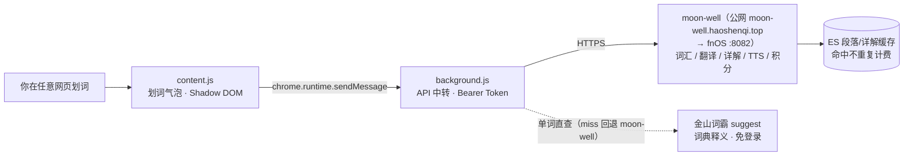

# MagicLens 词镜

把 magicbook 的阅读能力带到整个 Web 的 Chrome 扩展：在**任意网页**上划词翻译、查看单词详解、自动高亮生词、标记认识/生词、朗读，还可以随时唤起 AI 伴读。数据与词汇表和 [magicbook](https://github.com/haoshenqi-family/magicbook) 完全互通——整个互联网都是你的英文书。

> 命名寓意：透镜（lens）= 对准任意页面，透视出翻译、生词与朗读；与 magicbook 同姓 magic。

## 核心功能

### 划词即查

| 功能 | 说明 |
| --- | --- |
| 划词翻译 | **单个英文单词**自动直连金山词霸词典（免登录、百毫秒级），未命中回退 moon-well 翻译；**短语、句子及含中文的选区不自动翻译**——气泡突出「AI」按钮，点击把原文带入 AI 伴读输入框，「译」按钮保留为手动翻译；`iframe` 内（含 magicbook 阅读器 epub.js 正文）同样可用 |
| 单词详解 | 六板块结构化详解：基本意思 / 词源 / 搭配·用法·习语 / 变体与衍生词 / 同反义词 / 俚语冷知识；划词 `ran` 自动还原词目 `run`；服务端缓存，重复查询不重复计费 |
| 划词朗读 | 单词播有道词典真人美式音频；短语/句子或被页面 CSP 拦截时回退浏览器语音合成；不经后端、零积分 |
| 问 AI | 选区一键进 AI 伴读输入框，就着上下文继续问 |

### 生词管理

| 功能 | 说明 |
| --- | --- |
| 生词智能高亮 | 英文页自动扫描，按与 magicbook 阅读器**同一判定矩阵**（手动标记优先 + 难度档位兜底）给生词画波浪线（CSS Custom Highlight API，零 DOM 改动）；**悬浮生词直接弹出完整划词气泡**；SPA 动态内容增量判定。开关：popup 或 `Alt+U`，「重新扫描本页」在 popup |
| 标记认识 / 加入生词本 | 气泡一键标记，本页所有同词形（含常见变形）即时点亮/熄灭；数据写入与 magicbook 互通的生词本与阅读事件流 |

### AI 伴读

| 功能 | 说明 |
| --- | --- |
| 伴读聊天抽屉 | 任意网页唤起 magicbook 同款 AI 伴读：流式对话、会话列表（网页会话带「[通用]」前缀）、跨书记忆与学情面板；回复中的本站链接安全渲染为可点链接 |
| 语音双向 | 🎤 录音转写进输入框（可编辑后发送，不自动发送）；🔊 每条回复可朗读（moon-well TTS，1 积分/次，长回复自动分段顺序播）；抽屉顶部语速按钮 **1.0 / 0.75 / 0.5x** 循环，变速不变调（换档下一段生效） |

### 常驻入口

| 功能 | 说明 |
| --- | --- |
| 悬浮球 | 设置页开启后，除 magicbook 站内（保留站点自带悬浮球）外的网页右下角显示扩展悬浮球：buddy 伙伴形象，hover 弹出径向快捷气泡（💬 伴读对话 / 〰 高亮开关 / 🎓 每日学习 / 📚 书库 / 👤 我）；可拖拽、吸附左右边缘并按站点记忆位置；首次安装有引导，默认关闭。**球上方常驻「滚动复习」词卡**（对齐 magicbook R285/R289）：SRS 到期词每 8 秒轮播、详情分页每页 ≤3 行（只读缓存零计费，无缓存自动回退简卡）、点「认识」移出队列；可暂停（▶/❚❚）、可收起成角标，状态按浏览器记忆 |
| 域名管理 | 设置页维护「禁用 MagicLens 的域名」名单（自动覆盖全部子域），弹窗可一键禁用/恢复当前站点；名单随浏览器账号同步，刷新后生效 |
| 设置页 | Authentik OIDC 登录（与 magicbook 同一账号），令牌自动保存并静默续期，**无需手动填任何 Token**；难度等级、词汇量测试等详细设置直达 magicbook「阅读设置」 |

> 规划中（P1）：段落整页翻译。

## 安装（五步上手）

1. **下载**：从 [GitHub Releases](https://github.com/haoshenqi-family/magiclens/releases) 下载 `magiclens-extension-vX.Y.Z.zip` 并解压得到 `extension/`（想尝鲜可克隆仓库加载最新开发版）；
2. **加载**：Chrome 打开 `chrome://extensions`，右上角开启「开发者模式」→「加载已解压的扩展程序」→ 选择 `extension/` 目录；
3. **登录**：点扩展图标 → 「设置」→ **「登录」**，走 moon-well 统一登录页（Authentik，与 magicbook 同一账号；没有账号点「注册」走邀请制流程），成功后令牌自动保存并静默续期；
4. **划词试试**：随便打开一个英文网页，选中一个单词——译文气泡立即弹出，点「详」看六板块详解；
5. **按需开启**：popup 里开「生词高亮」（快捷键 `Alt+U`），设置页里开「常驻入口」悬浮球。

### 更新

扩展**不上架 Chrome Web Store**，仅经 GitHub Releases 分发：更新需重新下载 zip 并在 `chrome://extensions` 重载（无自动更新）。带 `X.Y.Z-时间戳` 后缀的是测试版（不发 Release），纯 `X.Y.Z` 是正式版。

## 与 magicbook 的关系

插件是 magicbook 阅读能力的浏览器版——同一账号、同一后端（moon-well），划词翻译 / 生词本 / 长期记忆 / 伴读 AI 数据完全互通；magicbook 读书架里的电子书，MagicLens 把整个网页当作你的书。

## 架构

插件是纯前端，调用 [moon-well](https://github.com/haoshenqi-family/moon-well)（私有仓库）的 API：

- 所有 moon-well 请求经 background service worker 中转：MV3 中 content script 的 fetch 遵循页面源 CORS 规则，service worker 持有 `host_permissions` 豁免，且不受 http 页面混合内容限制。
- UI 全部挂在 closed Shadow DOM：与页面样式完全互不干扰。

## API 契约速查

以 moon-well 代码为准（`ReadingVocabularyController` / `VocabularyController` / `ReadingSettingsController`），统一包装 `Result{success, result, message}`：

| 端点 | 方法 | 请求体 | 说明 |
| --- | --- | --- | --- |
| `/vocabulary/reading/translate` | POST | `{text}`（1..2000） | 划词/选区翻译 → `{text, translation, source}` |
| `/vocabulary/reading/translate-batch` | POST | `{paragraphs[≤20], bookName?, chapter?}` | 段落批量翻译 → `List<String>` |
| `/vocabulary/reading/analyze` | POST | 阅读上下文（bookId 等可空） | 生词判定 → 需标注的词列表 |
| `/vocabulary/known/{word}` · `/unknown/{word}` | GET | — | 标记认识 / 入生词本 |
| `/vocabulary/detail/{word}` | GET | — | 单词详解：六板块结构化 JSON；变体入参自动还原词目 |
| `/vocabulary/reading/settings` | GET | — | 阅读偏好（也用作连接测试） |
| `/tts/speak` | POST | `{text}`（1..2000） | 伴读回复朗读：音频二进制（失败时为 Result 信封 JSON）；不带书上下文落 7 天临时缓存档 |
| `/learning/asr/transcribe` | POST | multipart `file`（wav，≤10MB） | 语音转写：伴读抽屉麦克风输入 → `{text}`；直传不落存储 |
| `/learning/srs/queue` | GET | — | 滚动复习：SRS 到期队列（due_at≤now 含积压，默认 20 条）→ 词卡轮播数据源（只读） |
| `/vocabulary/detail/cached-batch` | POST | `{words[≤50]}` | 滚动复习详情分页：批量取「已缓存详解」（只读缓存，miss 词不出现、绝不触发生成——对端 moon-well R248/magicbook R289） |
| `/learning/strands/lookup` | POST | `{word}`（≤64） | 金山直连查词补报四股台账：fire-and-forget，服务端同词同日幂等 |
| `/auth/enrollment-invite` | GET | —（匿名，无需登录） | 注册邀请链接下发：`{inviteUrl}`；链接唯一真值源在 moon-well Nacos（轮换改后端一处即生效，R61 起扩展不再内置） |

## 隐私

令牌只存浏览器本地（`chrome.storage.sync`），不经过任何第三方；详见 [PRIVACY.md](PRIVACY.md)。

## 关联项目

- [magicbook](https://github.com/haoshenqi-family/magicbook)：阅读站点（划词/高亮/伴读逻辑的移植来源）
- [moon-well](https://github.com/haoshenqi-family/moon-well)（私有）：后端 API
